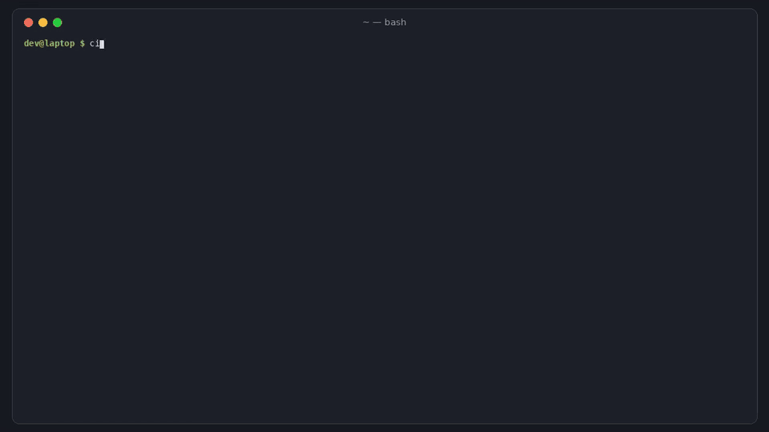

# ciwaste

[](https://github.com/hamarshehmhmd/ciwaste/actions/workflows/ci.yml)
[](LICENSE)
[](pyproject.toml)

**Find the GitHub Actions minutes you pay for and don't need.**
Per-workflow / per-job / per-runner cost, plus the waste: superseded runs that kept going, the same commit tested twice by `push` + `pull_request`, flaky jobs re-run until green, hung jobs, and scheduled runs on an unchanged commit. Every item links to the run. There's also an offline linter that points at the workflow lines causing it.



> Narrated 2.5-minute demo video: see the [v0.1.0 release](https://github.com/hamarshehmhmd/ciwaste/releases/tag/v0.1.0) (`demo.mp4`).

## Why

GitHub's billing page tells you how many minutes you used, not which workflow, job or habit burned them. Meanwhile the waste is invisible:

- an old PR run keeps going after you push a new commit, and is billed to the end
- `on: [push, pull_request]` runs every PR commit twice
- a hung job bills up to 360 minutes (the default `timeout-minutes`)
- macOS minutes cost ~10x Linux, so a macOS matrix on every PR adds up fast
- flaky jobs you "just re-run" are billed for every red attempt

`ciwaste` reads your runs and jobs from the GitHub API, prices them at GitHub's public list rates, and tells you where the money goes and what to change.

## Install

One line (uses `uv tool`, then `pipx`, else a private venv in `~/.local/share/ciwaste`):

```sh
curl -fsSL https://raw.githubusercontent.com/hamarshehmhmd/ciwaste/main/install.sh | sh
```

Or directly:

```sh
pipx install git+https://github.com/hamarshehmhmd/ciwaste
# or
pip install git+https://github.com/hamarshehmhmd/ciwaste
```

Needs Python 3.9+. The only dependency is PyYAML.

## Usage

```sh
# cost + waste report for a repo (token from GITHUB_TOKEN, GH_TOKEN or `gh auth token`)
ciwaste report OWNER/REPO --days 30

# inside a checkout, the repo is detected from the git remote
ciwaste report

# save the API data once, analyze offline as often as you like
ciwaste fetch OWNER/REPO --days 30 -o snapshot.json
ciwaste report snapshot.json --format markdown    # or text / json

# offline lint of .github/workflows (no token, no network)
ciwaste lint .
ciwaste lint . --format github --strict           # annotations; exit 1 on warnings

# the per-minute prices used
ciwaste rates
```

Useful `report` options: `--branch`, `--workflow ci.yml`, `--top N`, `--rate LABEL=USD` (custom / larger runner labels), `--self-hosted-rate USD`, `--count-default-branch`, `--fail-over USD` and `--fail-over-pct PCT` (exit 2 when monthly waste is over budget), `--save FILE`.

### What it finds

| kind | what it means | the fix it suggests |
|---|---|---|
| `superseded` | a newer commit landed on the same PR/branch while this run was still going | `concurrency:` group with `cancel-in-progress: true` |
| `duplicate` | the same commit ran for both `push` and `pull_request` | limit `push:` to `branches: [main]` |
| `flaky-rerun` | a job failed, then passed when re-run | fix or quarantine the flaky job |
| `hung` | a job ran ≥3x (and ≥15 min over) its usual p90 time | set `timeout-minutes` |
| `schedule-no-change` | a scheduled run on a commit that already passed the previous scheduled run | skip when unchanged, or run less often |

Overtaken runs on the default branch are listed but not counted as waste (you may want every `main` commit tested) unless you pass `--count-default-branch`.

### Lint rules

| rule | |
|---|---|
| `CW101` no-cancel-in-progress | PR/branch-triggered workflow without a `concurrency` group that cancels in progress |
| `CW102` no-timeout | job without `timeout-minutes` (default 360) |
| `CW103` push-and-pull-request | `push` without a branch filter plus `pull_request`: every PR commit runs twice |
| `CW104` frequent-schedule | cron that fires more than once an hour |
| `CW105` macos-on-pull-request | macOS job running on every pull request |

Skip any with `--ignore CW102`.

### Example (real output, `pallets/click`, last 100 runs)

```
ciwaste  pallets/click  last 8.11 days  (public repo: standard runners are free here, $ is the private-repo list price)
100 runs · 605 jobs · 641 billed min · $9.58 list price  (~$35.46 / 30 days)

  runner (billing SKU)  jobs  billed min   cost  share
  actions_macos           68          99  $6.14    64%
  actions_linux          489         494  $2.96    31%
  actions_windows         48          48  $0.48     5%
  macOS is 64% of the bill: the same 99 minutes on Linux would cost $0.59

Waste: $1.64 (17% of the bill)  ~$6.05 / 30 days
      $1.50  Scheduled runs on an unchanged commit  88 min  8 runs  in nightly.yaml, lock.yaml
      $0.13  Same commit tested twice (push + pull_request)  12 min  3 runs  in tests.yaml, pre-commit.yaml
```

(Public repos don't pay for standard runners; the dollar figures show what the same usage would cost in a private repo.)

## GitHub Action

Writes the report to the job summary, optionally lints your workflows (as annotations) and can act as a budget gate.

```yaml
name: ciwaste
on:
  schedule: [{cron: "0 6 * * 1"}]   # weekly
  workflow_dispatch:
permissions:
  actions: read
  contents: read
jobs:
  report:
    runs-on: ubuntu-latest
    timeout-minutes: 15
    steps:
      - uses: actions/checkout@v5
      - uses: hamarshehmhmd/ciwaste@v0.1.0
        with:
          days: "30"
          fail-over: "50"     # optional: fail if estimated waste > $50 / 30 days
```

Inputs: `repo` (default the current repo), `days` (30), `max-runs` (1000), `fail-over` (USD, empty = never fail), `lint` (`true`), `args` (extra `ciwaste report` args), `token` (default `github.token`, needs `actions: read`).

## Limits (read these)

- These are **estimates from public list prices**, not your invoice. Included free minutes, discounts and enterprise contracts are not applied.
- Each job is rounded up to a whole minute, like GitHub bills.
- The runs API returns at most 1,000 runs per query; with `--max-runs` hit, figures cover the newest runs and are scaled to 30 days (the report says so).
- Self-hosted minutes count as $0 unless you pass `--self-hosted-rate`.
- Larger-runner labels are matched by name; pass `--rate LABEL=USD` for custom labels.

## Demo

`docs/demo.gif` above is a short cut of the narrated demo (`demo.mp4`, attached to the [release](https://github.com/hamarshehmhmd/ciwaste/releases/tag/v0.1.0)). It is rendered from real command output by `demo/render.py`.

## Development

```sh
pip install -e . pytest
pytest -q
ciwaste lint examples/wasteful
```

## License

ciwaste is licensed under the **GNU Affero General Public License v3.0 or later** (AGPL-3.0-or-later), see [LICENSE](LICENSE).

Commercial licenses without AGPL obligations are available from the author, Mohammad Hamarsheh (open an issue or contact via GitHub [@hamarshehmhmd](https://github.com/hamarshehmhmd)).
